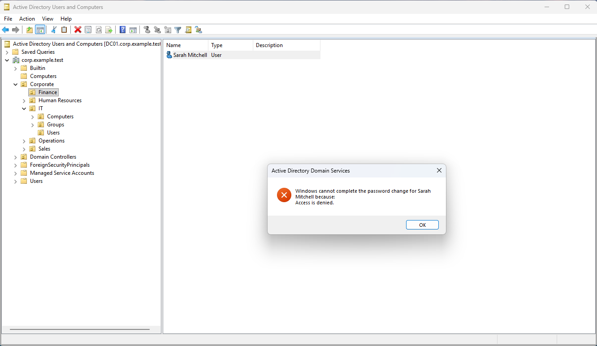
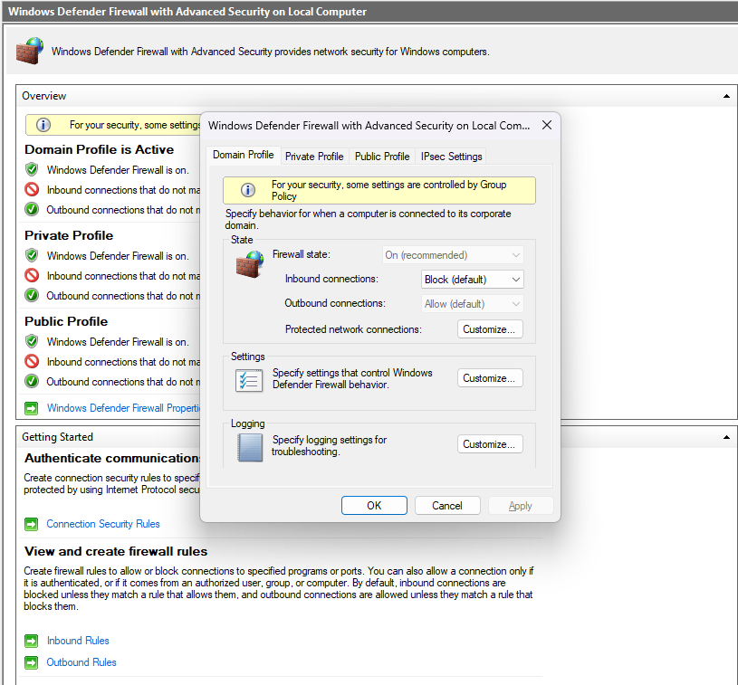
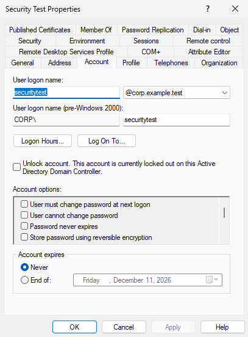
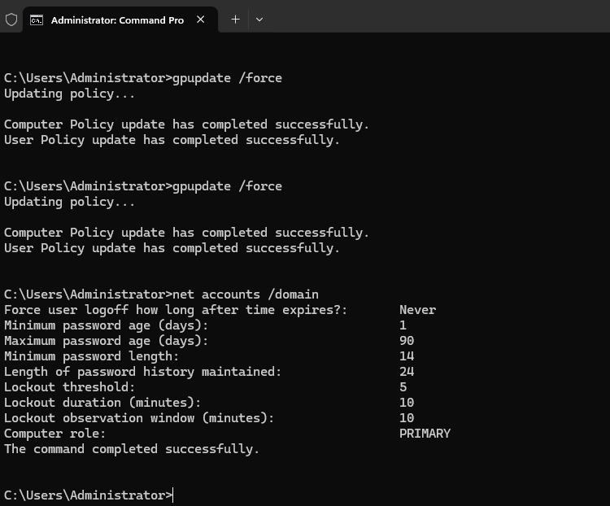
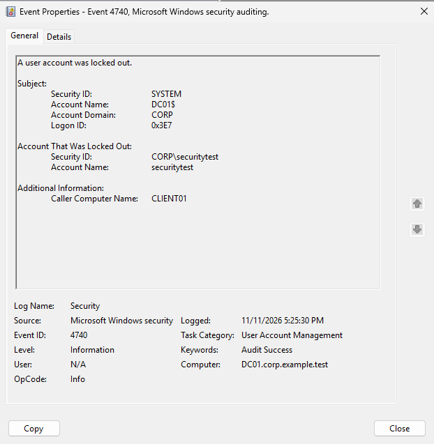
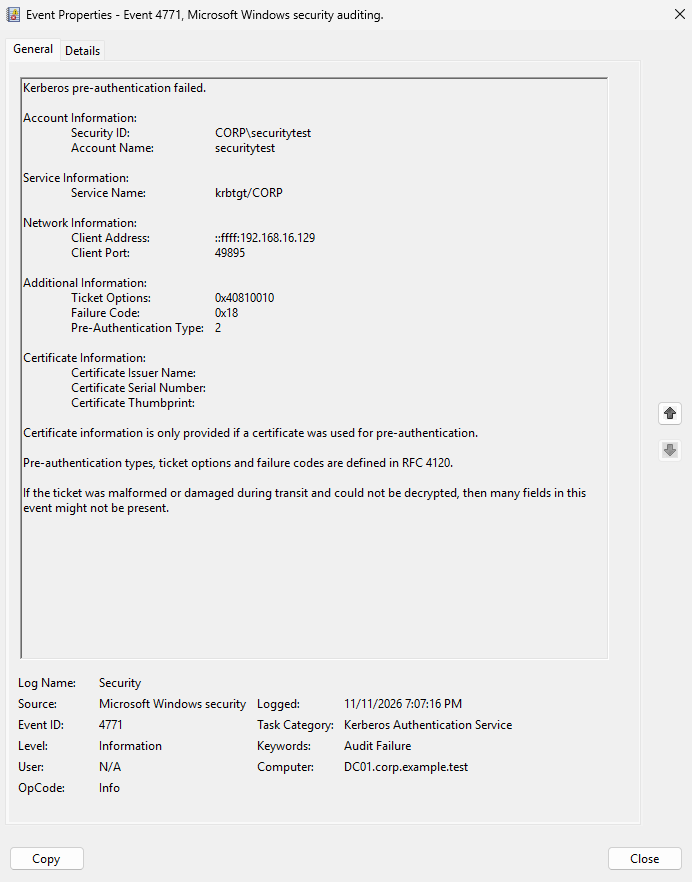
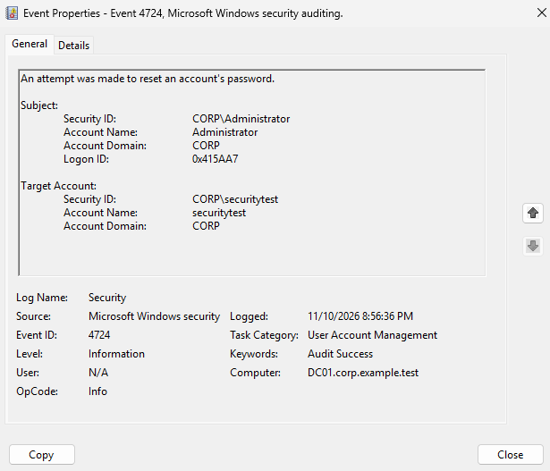

# Enterprise Active Directory Lab

**Windows Server 2025 | Windows 11 Pro | Active Directory | Group Policy | VMware Workstation**

## Project Overview

Designed and deployed a virtualized Windows enterprise environment to demonstrate Active Directory administration, organizational unit design, role-based access control (RBAC), delegated administration, and centralized workstation security management.

The lab focuses on practical enterprise IT operations, security best practices, and least-privilege administration.

## Lab Infrastructure

| Component | Configuration |
|---|---|
| Hypervisor | VMware Workstation |
| Domain Controller | DC01 — Windows Server 2025 |
| Client Workstation | CLIENT01 — Windows 11 Pro |
| Active Directory Domain | corp.example.test |
| Domain Controller IP | 192.168.16.10 |
| Virtual Network | VMware NAT (VMnet8) |
| DNS | Active Directory-integrated DNS |

## Active Directory Architecture

Created a departmental OU structure to support organized administration and policy targeting.

```text
corp.example.test
├── Corporate
│   ├── Finance
│   ├── Human Resources
│   ├── IT
│   │   ├── Computers
│   │   ├── Groups
│   │   └── Users
│   ├── Operations
│   ├── Sales
│   └── Workstations
└── Domain Controllers
```

## Role-Based Access Control and Delegation

Created the `SG_IT_Support` global security group and delegated limited administrative permissions over the IT Users OU.

**Delegated capabilities:**
- Reset user passwords
- Require password changes at next logon
- Read user information

Validated delegation using a standard domain account through Remote Server Administration Tools (RSAT) on CLIENT01.

### Security Validation

| Test | Result |
|---|---|
| IT technician resets an IT user's password | PASS |
| IT technician attempts to reset a Finance user's password | ACCESS DENIED |
| Remote Active Directory administration using RSAT | PASS |
| Administrative access restricted by OU scope | PASS |

## Group Policy Security Baseline

Created `GPO_Workstation_Security_Baseline` and linked it to the Corporate Workstations OU.

Configured Windows Defender Firewall Domain Profile:

| Setting | Configuration |
|---|---|
| Firewall state | Enabled |
| Inbound connections | Block by default |
| Outbound connections | Allow by default |

Verified successful policy application on CLIENT01 using `gpupdate /force`, `gpresult`, and Windows Defender Firewall with Advanced Security.

## Technical Skills Demonstrated

- Windows Server 2025 administration
- Active Directory Domain Services (AD DS)
- DNS and domain controller discovery
- Organizational Unit design
- Security group management
- Role-based access control (RBAC)
- Least-privilege delegation
- Remote Server Administration Tools (RSAT)
- Group Policy Management (GPMC)
- Windows Defender Firewall
- Domain-joined Windows 11 administration
- VMware virtual networking
- Enterprise troubleshooting and validation

## Project Status

**Functional lab — ongoing development**

Completed security implementations include delegated
administration, workstation firewall enforcement through
Group Policy, domain account lockout protection, and
domain password policy hardening.

Planned enhancements include Windows security event
auditing, administrative activity monitoring, and
additional security validation.

## Security Validation Screenshots

### Delegated Administration — Access Denied



### Group Policy — Domain Firewall Enforcement



### Account Lockout Policy — Security Validation

Configured and successfully tested domain account lockout
policies using Windows Server 2025 Active Directory.

- Lockout threshold: 5 failed login attempts
- Lockout duration: 10 minutes
- Reset account lockout counter: 10 minutes
- Validation: Confirmed account lockout in Active Directory
  Users and Computers after five failed login attempts



### Domain Password Policy — Security Hardening

Configured and verified domain-wide password security
settings using Windows Server 2025 Group Policy.

- Minimum password length: 14 characters
- Password history: 24 passwords remembered
- Minimum password age: 1 day
- Maximum password age: 90 days (lab configuration)
- Password complexity requirements: Enabled
- Verification: `gpupdate /force` followed by
  `net accounts /domain`



### Windows Security Auditing and Incident Investigation

Configured and validated Active Directory security auditing
on Windows Server 2025 to investigate authentication
failures, account lockouts, and administrative password
reset activity.

**Event ID 4740 — Account Lockout**

- Identified the locked account: `CORP\securitytest`
- Traced the originating workstation to `CLIENT01`
- Confirmed the domain controller recorded the lockout



**Event ID 4771 — Kerberos Pre-Authentication Failure**

- Enabled Kerberos failure auditing through Group Policy
- Generated a controlled failed authentication attempt
- Identified `securitytest` and source IP `192.168.16.129`
- Interpreted failure code `0x18` as invalid
  pre-authentication information



**Event ID 4724 — Administrative Password Reset**

- Reviewed an audited password reset attempt
- Identified the initiating account: `CORP\Administrator`
- Identified the target account: `CORP\securitytest`
- Confirmed the event was recorded as Audit Success



**Skills Demonstrated:** Windows Event Viewer,
Advanced Audit Policy Configuration, Group Policy,
Kerberos authentication analysis, account lockout
investigation, and Active Directory security monitoring.
