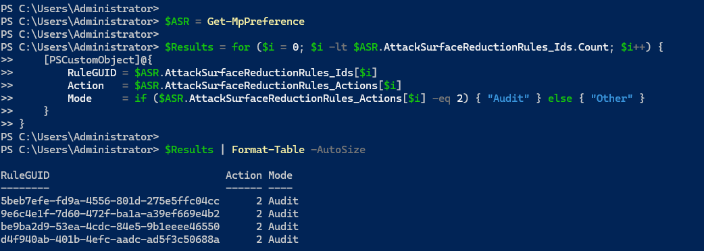
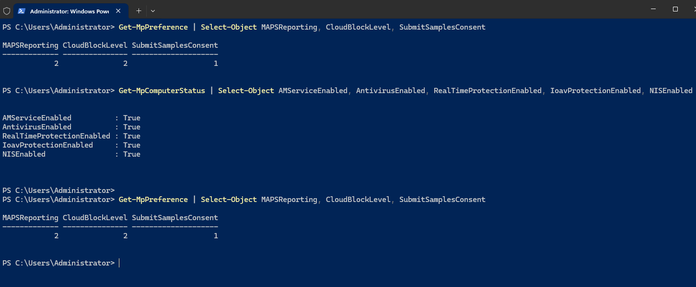
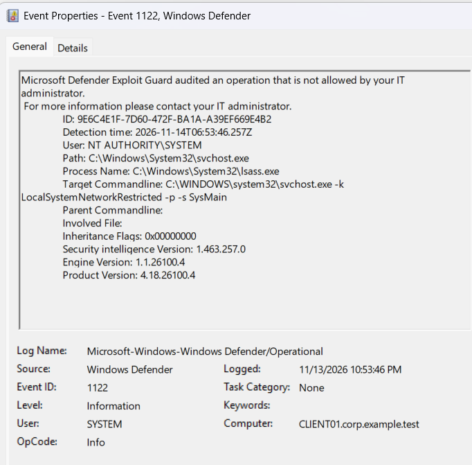
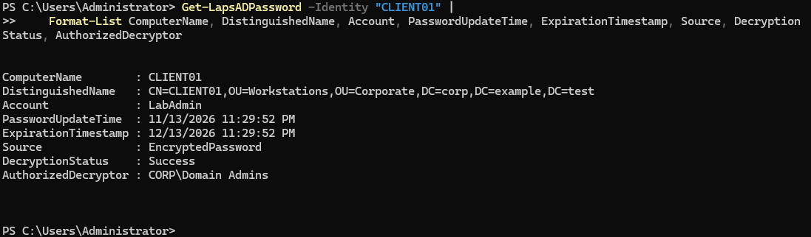

# Enterprise Active Directory Lab

**Windows Server 2025 | Windows 11 Pro | Active Directory | Group Policy | VMware Workstation**

## Project Overview

Designed and deployed a virtualized Windows enterprise environment to demonstrate Active Directory administration, organizational unit design, role-based access control (RBAC), delegated administration, and centralized workstation security management.

The lab focuses on practical enterprise IT operations, security best practices, and least-privilege administration.

## Lab Infrastructure

| Component | Configuration |
|---|---|
| Hypervisor | VMware Workstation |
| Domain Controller | DC01 — Windows Server 2025 |
| Client Workstation | CLIENT01 — Windows 11 Pro |
| Active Directory Domain | corp.example.test |
| Domain Controller IP | 192.168.16.10 |
| Virtual Network | VMware NAT (VMnet8) |
| DNS | Active Directory-integrated DNS |

## Active Directory Architecture

Created a departmental OU structure to support organized administration and policy targeting.

```text
corp.example.test
├── Corporate
│   ├── Finance
│   ├── Human Resources
│   ├── IT
│   │   ├── Computers
│   │   ├── Groups
│   │   └── Users
│   ├── Operations
│   ├── Sales
│   └── Workstations
└── Domain Controllers
```

## Role-Based Access Control and Delegation

Created the `SG_IT_Support` global security group and delegated limited administrative permissions over the IT Users OU.

**Delegated capabilities:**
- Reset user passwords
- Require password changes at next logon
- Read user information

Validated delegation using a standard domain account through Remote Server Administration Tools (RSAT) on CLIENT01.

### Security Validation

| Test | Result |
|---|---|
| IT technician resets an IT user's password | PASS |
| IT technician attempts to reset a Finance user's password | ACCESS DENIED |
| Remote Active Directory administration using RSAT | PASS |
| Administrative access restricted by OU scope | PASS |

## Group Policy Security Baseline

Created `GPO_Workstation_Security_Baseline` and linked it to the Corporate Workstations OU.

Configured Windows Defender Firewall Domain Profile:

| Setting | Configuration |
|---|---|
| Firewall state | Enabled |
| Inbound connections | Block by default |
| Outbound connections | Allow by default |

Verified successful policy application on CLIENT01 using `gpupdate /force`, `gpresult`, and Windows Defender Firewall with Advanced Security.

## Technical Skills Demonstrated

- Windows Server 2025 administration
- Active Directory Domain Services (AD DS)
- DNS and domain controller discovery
- Organizational Unit design
- Security group management
- Role-based access control (RBAC)
- Least-privilege delegation
- Remote Server Administration Tools (RSAT)
- Group Policy Management (GPMC)
- Windows Defender Firewall
- Domain-joined Windows 11 administration
- VMware virtual networking
- Enterprise troubleshooting and validation

## Project Status

**Functional lab — ongoing development**

Completed security implementations include delegated
administration, workstation firewall enforcement through
Group Policy, domain account lockout protection,
domain password policy hardening, and Windows Security
Event auditing.

Validated security events include Event ID 4740
(account lockout), Event ID 4771 (Kerberos authentication
failure), and Event ID 4724 (administrative password reset).

Planned enhancements include additional Group Policy
security controls, administrative activity monitoring,
and automated system administration.

## Security Validation Screenshots

### Delegated Administration — Access Denied


### Group Policy — Domain Firewall Enforcement


### Account Lockout Policy — Security Validation

Configured and successfully tested domain account lockout
policies using Windows Server 2025 Active Directory.

- Lockout threshold: 5 failed login attempts
- Lockout duration: 10 minutes
- Reset account lockout counter: 10 minutes
- Validation: Confirmed account lockout in Active Directory
  Users and Computers after five failed login attempts


### Domain Password Policy — Security Hardening

Configured and verified domain-wide password security
settings using Windows Server 2025 Group Policy.

- Minimum password length: 14 characters
- Password history: 24 passwords remembered
- Minimum password age: 1 day
- Maximum password age: 90 days (lab configuration)
- Password complexity requirements: Enabled
- Verification: `gpupdate /force` followed by
  `net accounts /domain`


### Windows Security Auditing and Incident Investigation

Configured and validated Active Directory security auditing
on Windows Server 2025 to investigate authentication
failures, account lockouts, and administrative password
reset activity.

**Event ID 4740 — Account Lockout**

- Identified the locked account: `CORP\securitytest`
- Traced the originating workstation to `CLIENT01`
- Confirmed the domain controller recorded the lockout


**Event ID 4771 — Kerberos Pre-Authentication Failure**

- Enabled Kerberos failure auditing through Group Policy
- Generated a controlled failed authentication attempt
- Identified `securitytest` and source IP `192.168.16.129`
- Interpreted failure code `0x18` as invalid
  pre-authentication information


**Event ID 4724 — Administrative Password Reset**

- Reviewed an audited password reset attempt
- Identified the initiating account: `CORP\Administrator`
- Identified the target account: `CORP\securitytest`
- Confirmed the event was recorded as Audit Success


**Skills Demonstrated:** Windows Event Viewer,
Advanced Audit Policy Configuration, Group Policy,
Kerberos authentication analysis, account lockout
investigation, and Active Directory security monitoring.


### Microsoft Defender Antivirus Security — Group Policy

Implemented centralized Microsoft Defender Antivirus security controls through Active Directory Group Policy on Windows 11 domain-joined workstations.

**Group Policy Configuration**
- GPO Name: `GPO-Workstations-Defender-Security`
- Linked OU: `Corporate/Workstations`
- Turn off Microsoft Defender Antivirus: Disabled
- Turn off real-time protection: Disabled
- Microsoft MAPS membership: Advanced MAPS
- Cloud protection level: High

**Validation and Testing**

Executed `gpupdate /force` on `CLIENT01` to refresh Group Policy.

Verified the Defender security GPO was applied using:

`gpresult /r /scope computer`

Validated Microsoft Defender protection using PowerShell:

`Get-MpComputerStatus`

Confirmed:
- Antivirus service enabled
- Antivirus protection enabled
- Real-time protection enabled
- Downloaded-file and attachment scanning enabled
- Network Inspection System enabled

Verified cloud protection configuration using:

`Get-MpPreference`

Results:
- MAPSReporting: 2 (Advanced MAPS)
- CloudBlockLevel: 2 (High)
- SubmitSamplesConsent: 1 (Prompt before sample submission)

**Security Outcome**

Successfully applied centralized Microsoft Defender security policies to a domain-joined Windows 11 workstation and verified effective protection settings through PowerShell.


### Microsoft Defender Attack Surface Reduction (ASR) — Audit Mode

Implemented centralized Microsoft Defender Attack Surface Reduction (ASR) policies through Active Directory Group Policy to strengthen endpoint security and evaluate potentially malicious behavior on domain-joined Windows 11 workstations.

**Group Policy Configuration**

- GPO Name: `GPO-Workstations-ASR-Protection`
- Linked OU: `Corporate/Workstations`
- Target Workstation: `CLIENT01`
- Deployment Method: Active Directory Group Policy
- Configuration Mode: Audit (`2`)

**Configured ASR Rules**

| Security Rule | Rule GUID | Mode |
|---|---|---|
| Block Office applications from creating child processes | `d4f940ab-401b-4efc-aadc-ad5f3c50688a` | Audit |
| Block credential stealing from LSASS | `9e6c4e1f-7d60-472f-ba1a-a39ef669e4b2` | Audit |
| Block executable content from email client and webmail | `be9ba2d9-53ea-4cdc-84e5-9b1eeee46550` | Audit |
| Block execution of potentially obfuscated scripts | `5beb7efe-fd9a-4556-801d-275e5ffc04cc` | Audit |

**Deployment and Validation**

Refreshed Group Policy on `CLIENT01`:

`gpupdate /force`

Verified the ASR GPO appeared under Applied Group Policy Objects:

`gpresult /r /scope computer`

Retrieved the effective ASR configuration using PowerShell:

```powershell
$ASR = Get-MpPreference

$Results = for ($i = 0; $i -lt $ASR.AttackSurfaceReductionRules_Ids.Count; $i++) {
    [PSCustomObject]@{
        RuleGUID = $ASR.AttackSurfaceReductionRules_Ids[$i]
        Action   = $ASR.AttackSurfaceReductionRules_Actions[$i]
        Mode     = if ($ASR.AttackSurfaceReductionRules_Actions[$i] -eq 2) { "Audit" } else { "Other" }
    }
}

$Results | Format-Table -AutoSize
```

**Validation Results**

- ASR GPO successfully applied to `CLIENT01`.
- All four configured ASR rule GUIDs detected.
- All four rules verified with action value `2` (Audit).
- Configuration verified through Microsoft Defender PowerShell cmdlets.

**Security Outcome**

Successfully deployed and validated centralized Microsoft Defender ASR policies in Audit Mode. This configuration enables evaluation of applicable ASR activity without enforcing blocking actions.

ASR audit-event generation and rule enforcement testing remain future validation activities.

**Evidence**



**Skills Demonstrated:** Active Directory, Group Policy Management, Microsoft Defender, Attack Surface Reduction, endpoint security hardening, PowerShell, security configuration validation.


**Evidence**




### ASR Security Event Investigation — Event ID 1122

Investigated a Microsoft Defender Attack Surface Reduction (ASR) audit event on a domain-joined Windows 11 workstation using Windows Event Viewer.

**Investigation Environment**

- Domain: `corp.example.test`
- Workstation: `CLIENT01`
- Security Platform: Microsoft Defender Antivirus
- Event Log: `Microsoft-Windows-Windows Defender/Operational`
- Event ID: `1122`
- Detection Mode: Audit

**Event Details**

| Property | Observed Value |
|---|---|
| Event ID | 1122 |
| ASR Rule | Block credential stealing from LSASS |
| Rule GUID | `9e6c4e1f-7d60-472f-ba1a-a39ef669e4b2` |
| Event Time | November 13, 2026, 10:53:46 PM PST |
| User Context | `NT AUTHORITY\SYSTEM` |
| Initiating Process | `C:\Windows\System32\svchost.exe` |
| Protected Process | `C:\Windows\System32\lsass.exe` |
| Associated Service | SysMain |
| Enforcement Result | Audited, not blocked |

**Investigation Procedure**

1. Opened Windows Event Viewer on `CLIENT01`.
2. Navigated to `Applications and Services Logs > Microsoft > Windows > Windows Defender > Operational`.
3. Filtered the Operational log for Event ID `1122`.
4. Examined the event's General and Details tabs.
5. Identified the triggering ASR rule using its GUID.
6. Reviewed the associated process paths, user context, and command-line information.

**Technical Analysis**

Microsoft Defender recorded an ASR audit event associated with an interaction involving `svchost.exe` and the protected LSASS process.

The target command line referenced the Windows SysMain service:

`C:\WINDOWS\system32\svchost.exe -k LocalSystemNetworkRestricted -p -s SysMain`

The event was generated under the `NT AUTHORITY\SYSTEM` security context.

Because the LSASS protection rule was configured in Audit Mode, Microsoft Defender recorded the activity without enforcing a block.

The event does not independently establish credential theft, malicious activity, or system compromise. The involvement of Windows system processes suggests that legitimate operating-system activity is a possible explanation.

**Investigation Outcome**

Successfully identified and analyzed a Microsoft Defender ASR audit event generated on a domain-joined workstation.

Confirmed that the LSASS credential protection rule produced security telemetry while operating in Audit Mode.

Further investigation would be required before classifying the activity as malicious or enabling blocking based on this event alone.

**Evidence**



**Skills Demonstrated:** Windows Event Viewer, Microsoft Defender, Attack Surface Reduction, endpoint security monitoring, LSASS protection, Windows process analysis, security event investigation, and technical documentation.

## Windows LAPS — Local Administrator Password Management

Implemented and validated Windows Local Administrator Password Solution (LAPS) in a Windows Server 2025 Active Directory environment.

### Configuration

- **Domain:** `corp.example.test`
- **Domain Controller:** `DC01`
- **Managed Workstation:** `CLIENT01` (Windows 11)
- **Group Policy:** `GPO-Workstations-Windows-LAPS`
- **Managed Local Administrator:** `LabAdmin`
- **Password Backup:** Active Directory
- **Password Encryption:** Enabled
- **Authorized Decryptors:** `CORP\Domain Admins`
- **Password Length:** 20 characters
- **Password Complexity:** Uppercase, lowercase, numbers, and special characters
- **Password Rotation Interval:** 30 days
- **Encrypted Password History:** 5

### Deployment and Validation

1. Extended the Active Directory schema with Windows LAPS attributes.
2. Configured computer self-permissions on the Workstations OU.
3. Created and linked the Windows LAPS Group Policy.
4. Verified Group Policy application using `gpresult /r /scope computer`.
5. Confirmed successful password rotation and Active Directory backup through Windows LAPS operational events.
6. Verified encrypted password retrieval metadata using `Get-LapsADPassword`.

**Validated Windows LAPS Events:**

| Event ID | Description |
|---|---|
| 10018 | Successfully backed up the managed password to Active Directory |
| 10020 | Successfully updated the local administrator password |
| 10021 | Confirmed effective Windows LAPS policy configuration |
| 10004 | Confirmed successful policy processing |

### Security Validation

PowerShell verification confirmed:

- `Source: EncryptedPassword`
- `DecryptionStatus: Success`
- `AuthorizedDecryptor: CORP\Domain Admins`
- Managed account: `LabAdmin`
- Password expiration scheduled 30 days after the successful update

The managed administrator password is not exposed in the repository.

### Evidence


