# Enterprise Active Directory Lab

**Windows Server 2025 | Windows 11 Pro | Active Directory | Group Policy | VMware Workstation**

## Project Overview

Designed and deployed a virtualized Windows enterprise environment to demonstrate Active Directory administration, organizational unit design, role-based access control (RBAC), delegated administration, and centralized workstation security management.

The lab focuses on practical enterprise IT operations, security best practices, and least-privilege administration.

## Lab Infrastructure

| Component | Configuration |
|---|---|
| Hypervisor | VMware Workstation |
| Domain Controller | DC01 — Windows Server 2025 |
| Client Workstation | CLIENT01 — Windows 11 Pro |
| Active Directory Domain | corp.example.test |
| Domain Controller IP | 192.168.16.10 |
| Virtual Network | VMware NAT (VMnet8) |
| DNS | Active Directory-integrated DNS |

## Active Directory Architecture

Created a departmental OU structure to support organized administration and policy targeting.

```text
corp.example.test
├── Corporate
│   ├── Finance
│   ├── Human Resources
│   ├── IT
│   │   ├── Computers
│   │   ├── Groups
│   │   └── Users
│   ├── Operations
│   ├── Sales
│   └── Workstations
└── Domain Controllers
```

## Role-Based Access Control and Delegation

Created the `SG_IT_Support` global security group and delegated limited administrative permissions over the IT Users OU.

**Delegated capabilities:**
- Reset user passwords
- Require password changes at next logon
- Read user information

Validated delegation using a standard domain account through Remote Server Administration Tools (RSAT) on CLIENT01.

### Security Validation

| Test | Result |
|---|---|
| IT technician resets an IT user's password | PASS |
| IT technician attempts to reset a Finance user's password | ACCESS DENIED |
| Remote Active Directory administration using RSAT | PASS |
| Administrative access restricted by OU scope | PASS |

## Group Policy Security Baseline

Created `GPO_Workstation_Security_Baseline` and linked it to the Corporate Workstations OU.

Configured Windows Defender Firewall Domain Profile:

| Setting | Configuration |
|---|---|
| Firewall state | Enabled |
| Inbound connections | Block by default |
| Outbound connections | Allow by default |

Verified successful policy application on CLIENT01 using `gpupdate /force`, `gpresult`, and Windows Defender Firewall with Advanced Security.

## Technical Skills Demonstrated

- Windows Server 2025 administration
- Active Directory Domain Services (AD DS)
- DNS and domain controller discovery
- Organizational Unit design
- Security group management
- Role-based access control (RBAC)
- Least-privilege delegation
- Remote Server Administration Tools (RSAT)
- Group Policy Management (GPMC)
- Windows Defender Firewall
- Domain-joined Windows 11 administration
- VMware virtual networking
- Enterprise troubleshooting and validation

## Project Status

**Functional lab — ongoing development**

Completed security implementations include delegated
administration, workstation firewall enforcement through
Group Policy, domain account lockout protection,
domain password policy hardening, and Windows Security
Event auditing.

Validated security events include Event ID 4740
(account lockout), Event ID 4771 (Kerberos authentication
failure), and Event ID 4724 (administrative password reset).

Planned enhancements include additional Group Policy
security controls, administrative activity monitoring,
and automated system administration.

## Security Validation Screenshots

### Delegated Administration — Access Denied

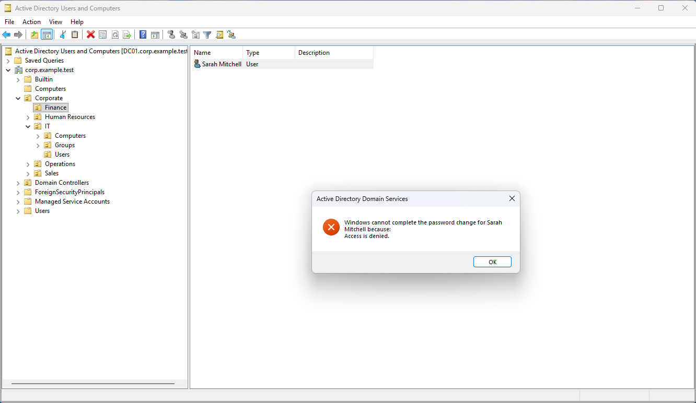

### Group Policy — Domain Firewall Enforcement

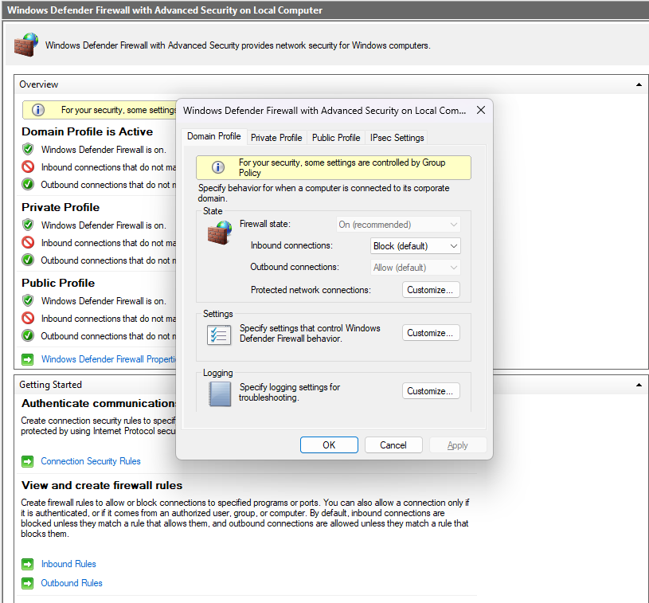

### Account Lockout Policy — Security Validation

Configured and successfully tested domain account lockout
policies using Windows Server 2025 Active Directory.

- Lockout threshold: 5 failed login attempts
- Lockout duration: 10 minutes
- Reset account lockout counter: 10 minutes
- Validation: Confirmed account lockout in Active Directory
  Users and Computers after five failed login attempts

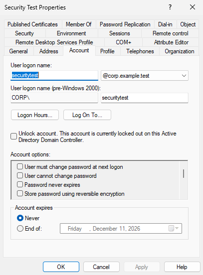

### Domain Password Policy — Security Hardening

Configured and verified domain-wide password security
settings using Windows Server 2025 Group Policy.

- Minimum password length: 14 characters
- Password history: 24 passwords remembered
- Minimum password age: 1 day
- Maximum password age: 90 days (lab configuration)
- Password complexity requirements: Enabled
- Verification: `gpupdate /force` followed by
  `net accounts /domain`

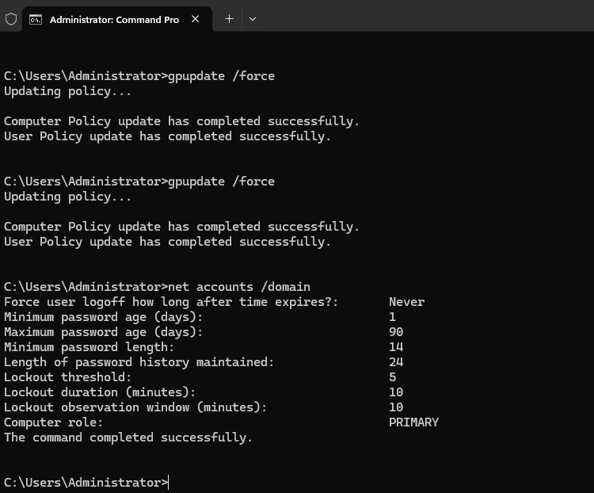

### Windows Security Auditing and Incident Investigation

Configured and validated Active Directory security auditing
on Windows Server 2025 to investigate authentication
failures, account lockouts, and administrative password
reset activity.

**Event ID 4740 — Account Lockout**

- Identified the locked account: `CORP\securitytest`
- Traced the originating workstation to `CLIENT01`
- Confirmed the domain controller recorded the lockout

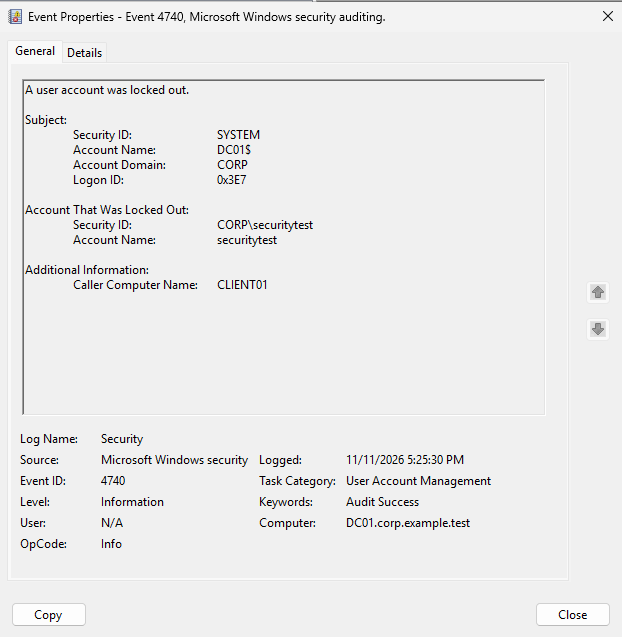

**Event ID 4771 — Kerberos Pre-Authentication Failure**

- Enabled Kerberos failure auditing through Group Policy
- Generated a controlled failed authentication attempt
- Identified `securitytest` and source IP `192.168.16.129`
- Interpreted failure code `0x18` as invalid
  pre-authentication information

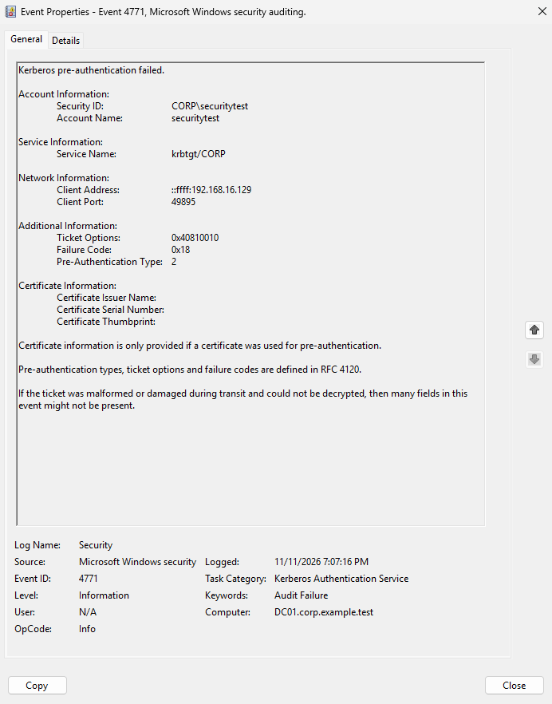

**Event ID 4724 — Administrative Password Reset**

- Reviewed an audited password reset attempt
- Identified the initiating account: `CORP\Administrator`
- Identified the target account: `CORP\securitytest`
- Confirmed the event was recorded as Audit Success

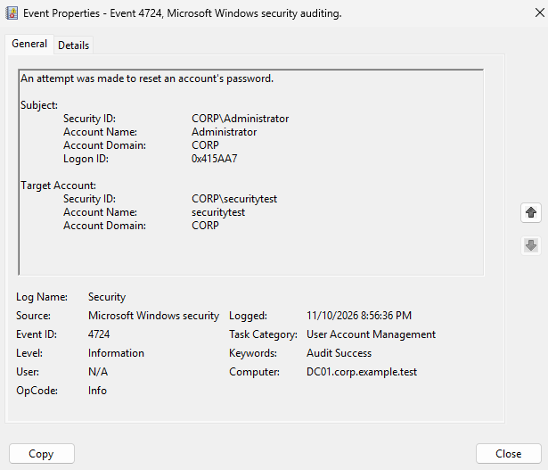

**Skills Demonstrated:** Windows Event Viewer,
Advanced Audit Policy Configuration, Group Policy,
Kerberos authentication analysis, account lockout
investigation, and Active Directory security monitoring.


### Microsoft Defender Antivirus Security — Group Policy

Implemented centralized Microsoft Defender Antivirus security controls through Active Directory Group Policy on Windows 11 domain-joined workstations.

**Group Policy Configuration**
- GPO Name: `GPO-Workstations-Defender-Security`
- Linked OU: `Corporate/Workstations`
- Turn off Microsoft Defender Antivirus: Disabled
- Turn off real-time protection: Disabled
- Microsoft MAPS membership: Advanced MAPS
- Cloud protection level: High

**Validation and Testing**

Executed `gpupdate /force` on `CLIENT01` to refresh Group Policy.

Verified the Defender security GPO was applied using:

`gpresult /r /scope computer`

Validated Microsoft Defender protection using PowerShell:

`Get-MpComputerStatus`

Confirmed:
- Antivirus service enabled
- Antivirus protection enabled
- Real-time protection enabled
- Downloaded-file and attachment scanning enabled
- Network Inspection System enabled

Verified cloud protection configuration using:

`Get-MpPreference`

Results:
- MAPSReporting: 2 (Advanced MAPS)
- CloudBlockLevel: 2 (High)
- SubmitSamplesConsent: 1 (Prompt before sample submission)

**Security Outcome**

Successfully applied centralized Microsoft Defender security policies to a domain-joined Windows 11 workstation and verified effective protection settings through PowerShell.


### Microsoft Defender Attack Surface Reduction (ASR) — Audit Mode

Implemented centralized Microsoft Defender Attack Surface Reduction (ASR) policies through Active Directory Group Policy to strengthen endpoint security and evaluate potentially malicious behavior on domain-joined Windows 11 workstations.

**Group Policy Configuration**

- GPO Name: `GPO-Workstations-ASR-Protection`
- Linked OU: `Corporate/Workstations`
- Target Workstation: `CLIENT01`
- Deployment Method: Active Directory Group Policy
- Configuration Mode: Audit (`2`)

**Configured ASR Rules**

| Security Rule | Rule GUID | Mode |
|---|---|---|
| Block Office applications from creating child processes | `d4f940ab-401b-4efc-aadc-ad5f3c50688a` | Audit |
| Block credential stealing from LSASS | `9e6c4e1f-7d60-472f-ba1a-a39ef669e4b2` | Audit |
| Block executable content from email client and webmail | `be9ba2d9-53ea-4cdc-84e5-9b1eeee46550` | Audit |
| Block execution of potentially obfuscated scripts | `5beb7efe-fd9a-4556-801d-275e5ffc04cc` | Audit |

**Deployment and Validation**

Refreshed Group Policy on `CLIENT01`:

`gpupdate /force`

Verified the ASR GPO appeared under Applied Group Policy Objects:

`gpresult /r /scope computer`

Retrieved the effective ASR configuration using PowerShell:

```powershell
$ASR = Get-MpPreference

$Results = for ($i = 0; $i -lt $ASR.AttackSurfaceReductionRules_Ids.Count; $i++) {
    [PSCustomObject]@{
        RuleGUID = $ASR.AttackSurfaceReductionRules_Ids[$i]
        Action   = $ASR.AttackSurfaceReductionRules_Actions[$i]
        Mode     = if ($ASR.AttackSurfaceReductionRules_Actions[$i] -eq 2) { "Audit" } else { "Other" }
    }
}

$Results | Format-Table -AutoSize
```

**Validation Results**

- ASR GPO successfully applied to `CLIENT01`.
- All four configured ASR rule GUIDs detected.
- All four rules verified with action value `2` (Audit).
- Configuration verified through Microsoft Defender PowerShell cmdlets.

**Security Outcome**

Successfully deployed and validated centralized Microsoft Defender ASR policies in Audit Mode. This configuration enables evaluation of applicable ASR activity without enforcing blocking actions.

ASR audit-event generation and rule enforcement testing remain future validation activities.

**Evidence**

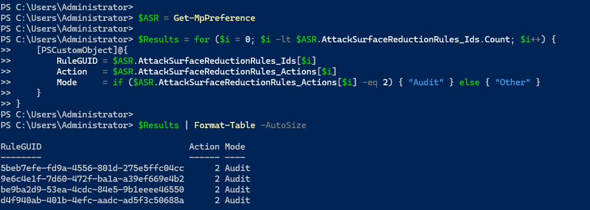

**Skills Demonstrated:** Active Directory, Group Policy Management, Microsoft Defender, Attack Surface Reduction, endpoint security hardening, PowerShell, security configuration validation.


**Evidence**

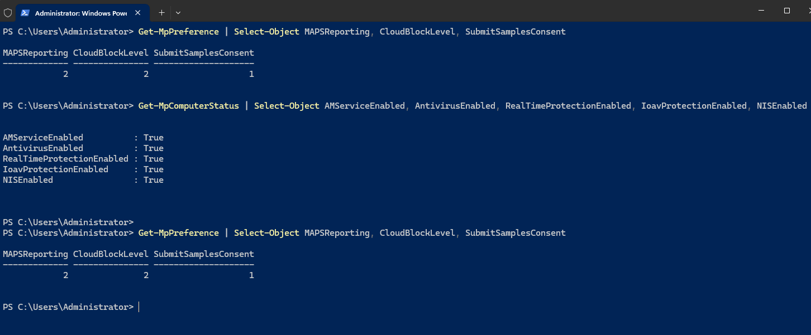


### ASR Security Event Investigation — Event ID 1122

Investigated a Microsoft Defender Attack Surface Reduction (ASR) audit event on a domain-joined Windows 11 workstation using Windows Event Viewer.

**Investigation Environment**

- Domain: `corp.example.test`
- Workstation: `CLIENT01`
- Security Platform: Microsoft Defender Antivirus
- Event Log: `Microsoft-Windows-Windows Defender/Operational`
- Event ID: `1122`
- Detection Mode: Audit

**Event Details**

| Property | Observed Value |
|---|---|
| Event ID | 1122 |
| ASR Rule | Block credential stealing from LSASS |
| Rule GUID | `9e6c4e1f-7d60-472f-ba1a-a39ef669e4b2` |
| Event Time | November 13, 2026, 10:53:46 PM PST |
| User Context | `NT AUTHORITY\SYSTEM` |
| Initiating Process | `C:\Windows\System32\svchost.exe` |
| Protected Process | `C:\Windows\System32\lsass.exe` |
| Associated Service | SysMain |
| Enforcement Result | Audited, not blocked |

**Investigation Procedure**

1. Opened Windows Event Viewer on `CLIENT01`.
2. Navigated to `Applications and Services Logs > Microsoft > Windows > Windows Defender > Operational`.
3. Filtered the Operational log for Event ID `1122`.
4. Examined the event's General and Details tabs.
5. Identified the triggering ASR rule using its GUID.
6. Reviewed the associated process paths, user context, and command-line information.

**Technical Analysis**

Microsoft Defender recorded an ASR audit event associated with an interaction involving `svchost.exe` and the protected LSASS process.

The target command line referenced the Windows SysMain service:

`C:\WINDOWS\system32\svchost.exe -k LocalSystemNetworkRestricted -p -s SysMain`

The event was generated under the `NT AUTHORITY\SYSTEM` security context.

Because the LSASS protection rule was configured in Audit Mode, Microsoft Defender recorded the activity without enforcing a block.

The event does not independently establish credential theft, malicious activity, or system compromise. The involvement of Windows system processes suggests that legitimate operating-system activity is a possible explanation.

**Investigation Outcome**

Successfully identified and analyzed a Microsoft Defender ASR audit event generated on a domain-joined workstation.

Confirmed that the LSASS credential protection rule produced security telemetry while operating in Audit Mode.

Further investigation would be required before classifying the activity as malicious or enabling blocking based on this event alone.

**Evidence**

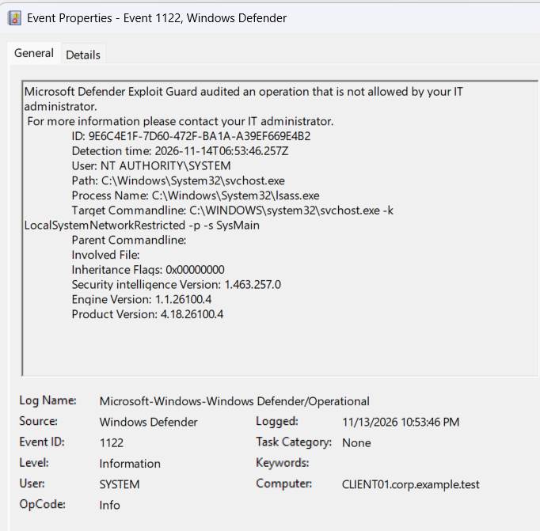

**Skills Demonstrated:** Windows Event Viewer, Microsoft Defender, Attack Surface Reduction, endpoint security monitoring, LSASS protection, Windows process analysis, security event investigation, and technical documentation.

## Windows LAPS — Local Administrator Password Management

Implemented and validated Windows Local Administrator Password Solution (LAPS) in a Windows Server 2025 Active Directory environment.

### Configuration

- **Domain:** `corp.example.test`
- **Domain Controller:** `DC01`
- **Managed Workstation:** `CLIENT01` (Windows 11)
- **Group Policy:** `GPO-Workstations-Windows-LAPS`
- **Managed Local Administrator:** `LabAdmin`
- **Password Backup:** Active Directory
- **Password Encryption:** Enabled
- **Authorized Decryptors:** `CORP\Domain Admins`
- **Password Length:** 20 characters
- **Password Complexity:** Uppercase, lowercase, numbers, and special characters
- **Password Rotation Interval:** 30 days
- **Encrypted Password History:** 5

### Deployment and Validation

1. Extended the Active Directory schema with Windows LAPS attributes.
2. Configured computer self-permissions on the Workstations OU.
3. Created and linked the Windows LAPS Group Policy.
4. Verified Group Policy application using `gpresult /r /scope computer`.
5. Confirmed successful password rotation and Active Directory backup through Windows LAPS operational events.
6. Verified encrypted password retrieval metadata using `Get-LapsADPassword`.

**Validated Windows LAPS Events:**

| Event ID | Description |
|---|---|
| 10018 | Successfully backed up the managed password to Active Directory |
| 10020 | Successfully updated the local administrator password |
| 10021 | Confirmed effective Windows LAPS policy configuration |
| 10004 | Confirmed successful policy processing |

### Security Validation

PowerShell verification confirmed:

- `Source: EncryptedPassword`
- `DecryptionStatus: Success`
- `AuthorizedDecryptor: CORP\Domain Admins`
- Managed account: `LabAdmin`
- Password expiration scheduled 30 days after the successful update

- ## Windows LAPS — Least-Privilege Access Validation

### Objective

Validate that standard domain users cannot retrieve protected Windows LAPS credentials while authorized administrators retain access.

### Test Environment

- **Domain:** `corp.example.test`
- **Domain Controller:** `DC01`
- **Workstation:** `CLIENT01`
- **Managed Local Administrator:** `LabAdmin`
- **Standard Test Account:** `CORP\securitytest`
- **Test Account Membership:** `Domain Users`

### Security Test Results

| Test | Result |
|---|---|
| Authorized administrator LAPS retrieval | Successful |
| Encrypted password decryption | Successful |
| Standard user Active Directory computer lookup | Successful |
| Standard user LAPS password record retrieval | No data returned |
| Plaintext password disclosure | Not observed |

### Validation Commands

Executed under the `CORP\securitytest` security context:

```powershell
whoami

Get-LapsADPassword -Identity "CLIENT01" |
    Format-List ComputerName, Account, Source, DecryptionStatus, AuthorizedDecryptor

Get-ADComputer -Identity "CLIENT01" |
    Select-Object Name, DistinguishedName
```

### Findings

The standard domain user successfully queried the `CLIENT01` computer object in Active Directory but received no password record from `Get-LapsADPassword`.

The previously validated Domain Administrator session successfully retrieved and decrypted the encrypted LAPS password record.

These results are consistent with the intended least-privilege configuration. No administrator passwords were exposed during testing or included in the repository.

### Evidence

**Authorized administrator validation:**

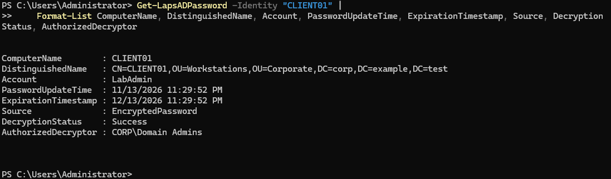

**Standard user access validation:**

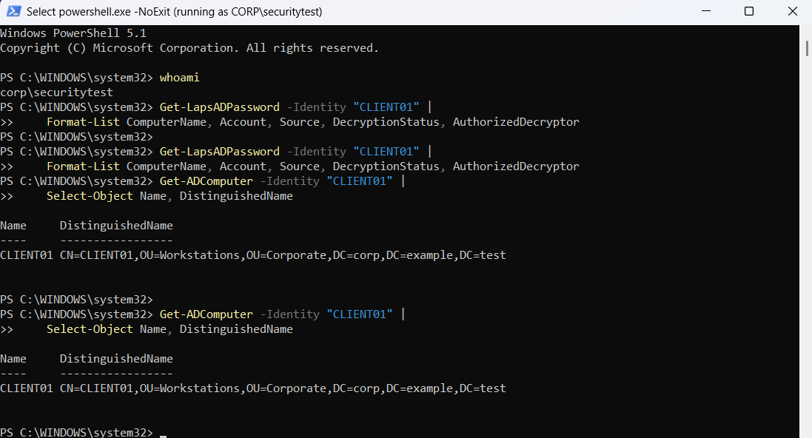

The managed administrator password is not exposed in the repository.

### Evidence


## Milestone 142 — Active Directory Security Auditing

### Overview

Developed and tested a read-only PowerShell security auditing script against a Windows Server 2025 Active Directory environment.

The script evaluates identity security configurations, privileged account membership, password policies, and potential authentication weaknesses.

### Security Audit Capabilities

- **Disabled Accounts:** Identifies disabled Active Directory user accounts.
- **Password Expiration:** Detects accounts configured with passwords that never expire.
- **Inactive Accounts:** Identifies enabled accounts with recorded last logons older than 90 days.
- **Privileged Groups:** Enumerates Domain Admins, Enterprise Admins, and Schema Admins.
- **Service Principal Names:** Identifies user accounts with registered SPNs.
- **Missing Logon History:** Identifies enabled accounts without a recorded replicated last-logon timestamp.
- **Password Not Required:** Detects enabled accounts configured without a password requirement.
- **Kerberos Preauthentication:** Identifies enabled accounts that do not require Kerberos preauthentication.

### Lab Environment

| Component | Configuration |
|---|---|
| Domain Controller | DC01 |
| Operating System | Windows Server 2025 |
| Active Directory Domain | corp.example.test |
| Automation | Windows PowerShell |
| AD Module | ActiveDirectory 1.0.1.0 |
| Execution | Read-only |

### Security Audit Findings

Testing identified:

- Two disabled built-in accounts: Guest and krbtgt.
- A non-expiring password configuration on the built-in Administrator account.
- Administrator as the only direct member of Domain Admins, Enterprise Admins, and Schema Admins.
- Two enabled accounts without recorded replicated last-logon timestamps.
- No enabled accounts configured with PasswordNotRequired.
- No enabled accounts configured to bypass Kerberos preauthentication.

These findings demonstrate identity security assessment and configuration review within a controlled Active Directory lab.

### PowerShell Script

**[View Get-ADSecurityAudit.ps1](scripts/Get-ADSecurityAudit.ps1)**

Run from an authorized Windows system with the Active Directory PowerShell module installed:

```powershell
.\Get-ADSecurityAudit.ps1
```

The script performs read-only checks and does not modify Active Directory objects.

### Skills Demonstrated

Active Directory administration, identity security auditing, PowerShell automation, privileged access assessment, Kerberos security configuration, and technical documentation.

## Milestone 143 — Active Directory Password Security Auditing

### Overview

Developed and tested a PowerShell-based Active Directory Password Security Audit tool in a Windows Server 2025 enterprise lab environment.

The script automates nine read-only security assessments to evaluate domain password policies, account security configurations, authentication protections, and potential identity security risks.

### Security Audit Capabilities

1. **Default Domain Password Policy** — Audits password complexity, minimum length, password history, expiration, and account lockout settings.
2. **Fine-Grained Password Policies** — Identifies custom password policies configured within Active Directory.
3. **Passwords Never Expire** — Detects enabled accounts configured with non-expiring passwords.
4. **Password Not Required** — Identifies enabled accounts with the PasswordNotRequired flag.
5. **Password Change Required** — Detects accounts configured to change passwords at their next logon.
6. **Account Lockouts** — Identifies currently locked-out accounts.
7. **Expired Passwords** — Reports accounts with expired passwords.
8. **Disabled Accounts** — Enumerates disabled Active Directory user accounts.
9. **Kerberos Pre-Authentication** — Identifies enabled accounts with Kerberos pre-authentication disabled.

### Lab Environment

| Component | Configuration |
|---|---|
| Domain Controller | DC01 |
| Operating System | Windows Server 2025 |
| Active Directory Domain | corp.example.test |
| Workstation | CLIENT01 — Windows 11 Pro |
| Scripting Language | PowerShell |
| PowerShell Module | ActiveDirectory |
| Audit Type | Read-only security assessment |

### Verified Security Findings

| Security Control | Audit Result |
|---|---|
| Password complexity | Enabled |
| Minimum password length | 14 characters |
| Password history | 24 passwords |
| Maximum password age | 90 days |
| Account lockout threshold | 5 attempts |
| Lockout duration | 10 minutes |
| Fine-grained password policies | None configured |
| Enabled accounts with non-expiring passwords | 1 — Built-in Administrator |
| Enabled accounts with PasswordNotRequired | None |
| Accounts requiring password change | 2 test accounts |
| Locked-out accounts | None |
| Expired passwords | None detected |
| Disabled accounts | Guest and krbtgt |
| Enabled accounts without Kerberos pre-authentication | None |

### PowerShell Automation

**Script:** [Get-ADPasswordAudit.ps1](scripts/Get-ADPasswordAudit.ps1)

Execute from an authorized Active Directory environment:

```powershell
.\Get-ADPasswordAudit.ps1
```

Export audit results to a text report:

```powershell
.\Get-ADPasswordAudit.ps1 *>&1 |
    Out-File "ADPasswordAudit-Report.txt" -Encoding UTF8
```

The script performs read-only queries and does not modify Active Directory accounts, passwords, or security policies.

### Technical Skills Demonstrated

- Active Directory Domain Services (AD DS)
- Windows Server 2025 administration
- PowerShell security automation
- Enterprise identity and access management (IAM)
- Password policy assessment
- Account lockout auditing
- Kerberos authentication security
- Security configuration analysis
- Audit reporting and documentation

### Outcome

Successfully developed, executed, and validated a reusable Active Directory password security auditing script.

The project demonstrates practical experience assessing enterprise authentication controls, identifying account security exceptions, and automating security reporting using PowerShell.

## Milestone 144 — Active Directory Group Policy Security Auditing

Developed and validated a read-only PowerShell auditing tool to assess Group Policy security across a Windows Server 2025 Active Directory environment.

### Implementation
- Inventoried all domain Group Policy Objects (GPOs).
- Audited GPO links, enabled status, and enforcement settings.
- Enumerated GPO security permissions and administrative trustees.
- Identified custom access control entries requiring additional review.
- Detected disabled GPO configuration sections.
- Generated an audit report for administrative review.

### Validation Results
- **7 Group Policy Objects** successfully audited.
- **8 enabled GPO links** identified.
- **35 permission entries** examined.
- **4 custom permission entries** identified on the default domain policies.
- **0 disabled GPO configuration sections** detected.
- No unexpected permission trustees identified during the review.

### Technologies
Windows Server 2025, Active Directory Domain Services, Group Policy Management, PowerShell, GroupPolicy Module, ActiveDirectory Module.

### PowerShell Script
[Get-ADGPOAudit.ps1](scripts/Get-ADGPOAudit.ps1)

**Outcome:** Implemented automated Group Policy security auditing with visibility into policy configuration, organizational scope, administrative permissions, and custom access control entries.

## Milestone 145 — Active Directory Privileged Access Security Auditing

Developed and validated a read-only PowerShell auditing tool to assess privileged group memberships and administrative account security in a Windows Server 2025 Active Directory environment.

### Implementation
- Audited nine privileged and security-sensitive Active Directory groups.
- Enumerated direct and nested group memberships using recursive membership queries.
- Identified unique privileged user accounts.
- Evaluated administrative account status and password expiration settings.
- Checked password modification dates and approximate last-logon activity.
- Flagged potentially inactive administrative accounts using a 90-day threshold.
- Examined the `AdminCount` attribute.
- Generated a security audit report for administrative review.

### Validation Results
- **9 privileged groups** successfully audited.
- **1 unique privileged user account** identified.
- **4 privileged groups** contained the built-in Administrator account.
- **5 groups** had no members returned by the recursive audit.
- **0 privileged accounts** flagged as inactive for 90 days.
- **1 security configuration** flagged for review: the enabled Administrator account has a non-expiring password.
- **0 script execution errors** observed.

### Security Findings

**REVIEW-001 — Non-Expiring Administrator Password**

The built-in Administrator account was configured with `PasswordNeverExpires = True`. This configuration requires review against organizational password management and privileged access policies.

The audit was performed in read-only mode. No Active Directory accounts, group memberships, or security settings were modified.

### Technologies
Windows Server 2025, Active Directory Domain Services, PowerShell, ActiveDirectory Module, Privileged Access Auditing.

### PowerShell Script
[Get-ADPrivilegedAccessAudit.ps1](scripts/Get-ADPrivilegedAccessAudit.ps1)

**Outcome:** Implemented automated privileged access auditing to improve visibility into administrative group memberships, account security configurations, and potential security risks.

## Milestone 146 — Active Directory Attack Surface Security Auditing

Developed and validated a read-only PowerShell security auditing tool to identify potentially risky Kerberos authentication and delegation configurations in a Windows Server 2025 Active Directory environment.

### Implementation
- Audited Active Directory objects with Kerberos preauthentication disabled.
- Enumerated user accounts with Service Principal Names (SPNs).
- Identified computer accounts configured for unconstrained delegation.
- Examined traditional and resource-based constrained delegation configurations.
- Audited user accounts configured for DES-only Kerberos encryption.
- Identified user accounts trusted for Kerberos delegation.
- Evaluated user account delegation restrictions.
- Assessed the built-in Administrator account's delegation protection.
- Generated an automated security assessment report.

### Validation Results
- **0 objects** identified with Kerberos preauthentication disabled.
- **1 user account with an SPN:** the built-in `krbtgt` account.
- **1 computer with unconstrained delegation:** `DC01`, the domain controller.
- **0 objects** configured for traditional constrained delegation.
- **0 objects** configured for resource-based constrained delegation.
- **0 user accounts** configured for DES-only Kerberos encryption.
- **0 user accounts** trusted for Kerberos delegation.
- **0 user accounts** explicitly protected against delegation.
- **1 security configuration** flagged for review.

### Security Finding

**REVIEW-001 — Administrator Delegation Protection**

The built-in Administrator account was enabled with `AccountNotDelegated = False`.

This configuration requires review because privileged accounts should generally be protected against Kerberos delegation.

The audit was performed in read-only mode. No Active Directory security settings were modified.

### Technologies
Windows Server 2025, Active Directory Domain Services, PowerShell, Kerberos Authentication, ActiveDirectory Module, Security Auditing.

### PowerShell Script
[Get-ADAttackSurfaceAudit.ps1](scripts/Get-ADAttackSurfaceAudit.ps1)

**Outcome:** Implemented automated Active Directory attack-surface auditing to improve visibility into Kerberos security, delegation configurations, and potentially risky administrative account settings.

## Milestone 147 — Kerberos Security Auditing

Implemented and validated Kerberos security auditing in the Windows Server 2025 Active Directory environment (`corp.example.test`).

### Security Controls and Findings

- **Kerberos encryption:** Verified AES-256 encryption for authentication and service tickets.
- **KRBTGT account:** Confirmed the built-in account is disabled and reviewed its password age.
- **Encryption compatibility:** Identified legacy RC4 support on DC01 for future hardening review.
- **Authentication auditing:** Verified successful and failed Kerberos authentication auditing.
- **Service-ticket auditing:** Enabled Success and Failure auditing through the Default Domain Controllers Policy.
- **Security monitoring:** Verified Windows Security Event IDs 4768, 4769, and 4771.

### Audit Results

| Security Metric | Result |
|---|---|
| Event ID 4768 — TGT Requests | 105 |
| Event ID 4769 — Service Ticket Requests | 4 |
| AES-256 Ticket Encryption | 109 observed requests |
| Event ID 4771 — Pre-Authentication Failures | 8 |
| RC4-Encrypted Tickets Observed | 0 |

All 109 recorded ticket requests in the audit report used AES-256 encryption. Eight pre-authentication failures were identified for further review; no malicious activity was confirmed.

### PowerShell Automation

**Script:** [Get-ADKerberosAudit.ps1](scripts/Get-ADKerberosAudit.ps1)

Developed a read-only PowerShell auditing tool that examines KRBTGT account properties, domain controller encryption support, Kerberos audit policy, and authentication security events.

The script generates a structured security report at `C:\Scripts\ADKerberos-Report.txt`.

**Status:** Completed — November 19, 2026.


---

## Milestone 148 — Active Directory Backup & Recovery

**Status: Completed — Backup Verified**

Implemented and validated Windows Server Backup on a Windows Server 2025 domain controller.

### Implementation
- Installed Windows Server Backup.
- Provisioned a dedicated 60 GB VMware virtual backup disk.
- Initialized the disk using GPT and formatted it as NTFS.
- Configured the `E:` volume for Active Directory backups.
- Successfully completed a System State backup using `wbadmin`.

### Verification
- Confirmed successful backup completion.
- Verified the backup version in the Windows Server Backup catalog.
- Confirmed NTDS, SYSVOL, and Registry components were included.
- Verified backup storage health and available capacity.
- Confirmed backup files exist on the dedicated backup volume.

### Recovery Readiness
- System State recovery is available in the backup catalog.
- Recovery procedures and limitations are documented.
- A test restore has not yet been performed.
- Off-host backup storage is recommended for disaster recovery.

**Documentation:** [Active Directory Backup & Recovery](AD-Backup-Recovery.md)


---

## Milestone 149 — Active Directory Security Monitoring & Reporting

**Status: Completed — Monitoring Validated**

Developed and tested a PowerShell security monitoring solution for Windows Server 2025 Active Directory.

### Security Monitoring Capabilities

- Kerberos authentication monitoring (4768, 4769)
- Kerberos pre-authentication failure detection (4771)
- NTLM credential validation monitoring (4776)
- Failed logon detection (4625)
- Account lockout monitoring (4740)
- User account creation and deletion monitoring (4720, 4726)
- Security group membership change monitoring (4728, 4732, 4756)
- Security audit log clearing detection (1102)

### Validation Results

- Successfully processed 158 Security log events.
- Identified 9 Kerberos pre-authentication failures.
- Reviewed authentication accounts, source addresses, and failure codes.
- Confirmed the monitoring script passed PowerShell syntax validation.
- Generated a seven-day security monitoring report.

### Security Findings

- Six Kerberos failures involved the Administrator account.
- Three Kerberos failures involved the securitytest account.
- Failure code 0x18 was observed.
- Historical source 192.168.16.129 could not be conclusively identified.
- No security incident was confirmed.

### Monitoring Script

[Get-ADSecurityMonitoring.ps1](scripts/Get-ADSecurityMonitoring.ps1)

### Limitations

- Monitoring is performed on demand, not continuously.
- Results depend on configured audit policies and retained event logs.
- The report includes the latest 10 matching events per category.
- Automated alerting and centralized log collection are not implemented.
